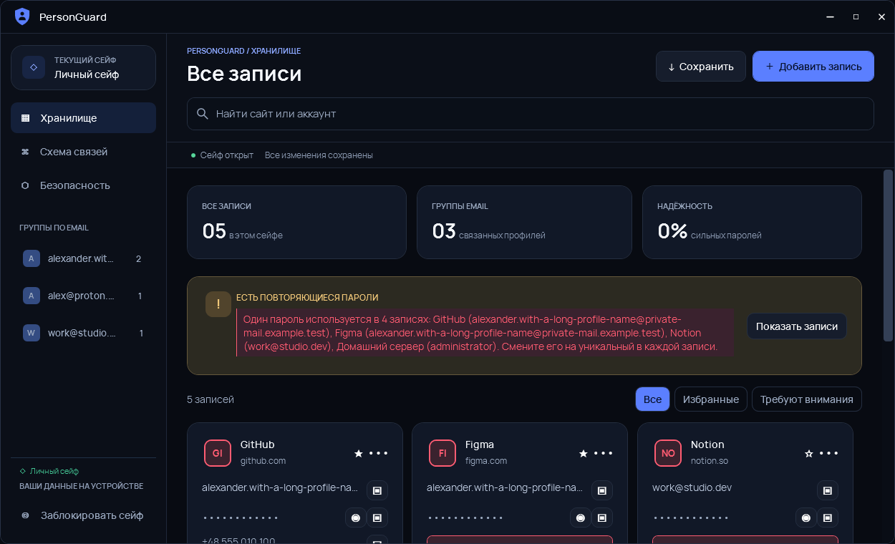

# PersonGuard

Локальный менеджер паролей для Windows 11 x64. Нативное WPF-приложение без аккаунта, сервера, телеметрии и синхронизации. Сейф — один зашифрованный файл `.pgd`, который открывается мастер-паролем или passkey (Windows WebAuthn PRF). Внутри: записи с сайтом, логином, телефоном и паролем, поиск повторяющихся паролей, группировка по email и схема связей.



> [!IMPORTANT]
> Облака и восстановления доступа нет. Храните резервную копию `.pgd` и мастер-пароль отдельно.

## Безопасность

- Argon2id (128 MiB, 4 прохода) и AES-256-GCM; заголовок файла аутентифицирован.
- Смена мастер-пароля и отключение passkey заменяют ключ шифрования сейфа.
- Секреты в памяти зашифрованы ключом, привязанным к процессу; другие программы пользователя не могут читать память PersonGuard.
- Повторное подтверждение перед показом и копированием, автоблокировка, защита окна от захвата экрана, буфер обмена выключен по умолчанию.

Модель угроз и ограничения — в [SECURITY.md](SECURITY.md). Независимого аудита не было. Вредоносная программа с правами администратора эту защиту обходит, поэтому работайте под стандартной учётной записью.

## Установка

Скачайте `PersonGuard.exe` и `PersonGuard.exe.sha256` из [Releases](../../releases/latest) и сверьте хеш (должно вывести `True`):

```powershell
(Get-FileHash .\PersonGuard.exe -Algorithm SHA256).Hash -eq (Get-Content .\PersonGuard.exe.sha256).Split()[0]
```

Положите exe в `C:\Program Files\PersonGuard`: из папки, доступной для записи без прав администратора, его может подменить вредоносная программа.

## Сборка

Нужен .NET 10 SDK: локальный в `.dotnet` или в `PATH`.

```powershell
.\build-desktop.ps1                                                           # build\PersonGuard.exe и .sha256
.\.dotnet\dotnet.exe run --project .\desktop\PersonGuard.SecurityTests -c Release   # тесты
```

Для подписи укажите отпечаток сертификата в `PERSONGUARD_SIGNING_THUMBPRINT`.

## Лицензия

© 2026 Clarence Everhart (qlarens), [CC BY-NC-ND 4.0](LICENSE). Шрифт Manrope — [SIL OFL 1.1](desktop/PersonGuard.Desktop/Assets/Fonts/Manrope/OFL.txt).
